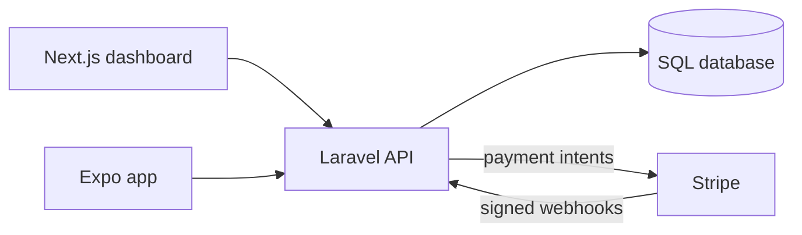

# PaidUp

[](https://github.com/dakiquang/paidup/actions/workflows/ci.yml)
[](LICENSE)

Invoices and payments for small businesses, built as one product across a Laravel API, a Next.js dashboard and an Expo app. The hard part it solves is taking money safely: a customer can't be charged twice, however many times they tap, retry or get declined.

## How it fits together



| Part | Stack | Does |
|---|---|---|
| `api/` | PHP 8.2, Laravel 12, Sanctum, Stripe | Customers, invoices, payments, webhooks |
| `web/` | Next.js 16, React 19, TypeScript, Tailwind CSS | Dashboard and Stripe checkout, token in an httpOnly cookie |
| `mobile/` | Expo 58, React Native, Expo Router | Sign in and invoice status on the go, token in the secure store |

## Payment rules

Each rule has a test in [`api/tests/Feature/PaymentTest.php`](api/tests/Feature/PaymentTest.php).

- **One live payment per invoice.** Paying again returns the same payment, so a double tap opens nothing new.
- **A decline keeps the same intent.** Retries go through it. A new intent is how an old payment screen and a new one both take money.
- **Cancel at the provider first.** The invoice reopens only after Stripe confirms the intent is dead.
- **Webhooks are signed, repeatable and checked.** Forged, replayed and mismatched events change nothing. A missing webhook secret refuses everything.
- **Paid stays paid.** A late decline or cancel can't undo it, and money in motion can't be voided.
- **Every business sees only its own data.** Other invoices return 404.

Amounts are integer cents, and the client secret is encrypted at rest.

## Status

The Stripe flow is covered with a fake gateway and real signature checks. It hasn't yet run against a live Stripe test account, and the Expo app hasn't yet run on a device or simulator: it passes typecheck, tests and `expo-doctor`, and the iOS bundle exports.

## Run it

Needs PHP 8.2, Composer, and Node 24.

```bash
cd api
composer install
cp .env.example .env
php artisan key:generate
php artisan migrate --seed
php artisan serve
```

```bash
cd web
npm ci
cp .env.example .env.local
npm run dev
```

```bash
cd mobile
npm ci
cp .env.example .env
npx expo start
```

Sign in with `demo@paidup.test` and `password`. This account exists only in the local seed. To take test payments, add your Stripe test keys to `api/.env` and `web/.env.local`, then forward events with `stripe listen --forward-to localhost:8000/api/webhooks/stripe`.

## Checks

| Part | Commands |
|---|---|
| API | `php artisan test`, `./vendor/bin/pint --test` |
| Web | `npm run lint`, `npm run typecheck`, `npm run coverage`, `npm run build` |
| Mobile | `npm run typecheck`, `npm run coverage` |

CI runs all of these on every push, and the API job fails below 90% coverage.

Built by [Quang Dang](https://quangdk.com).
